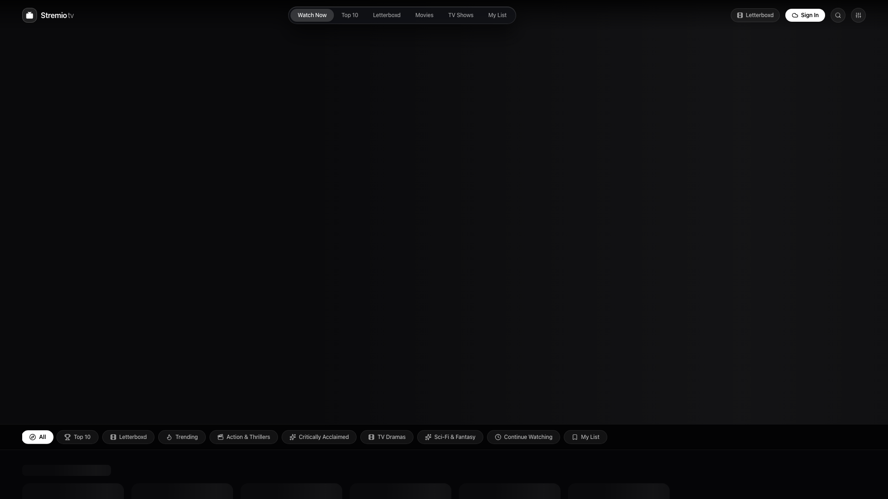
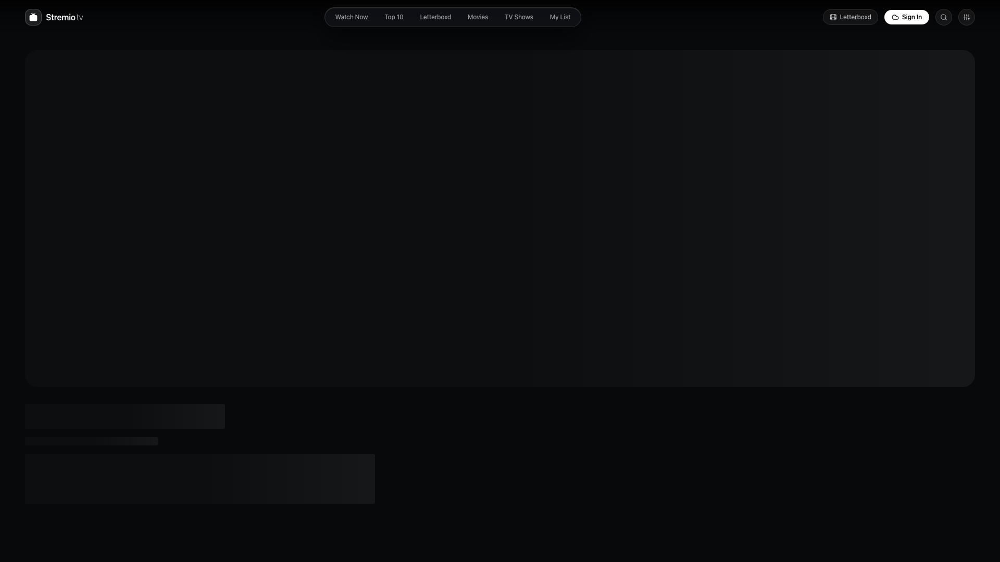
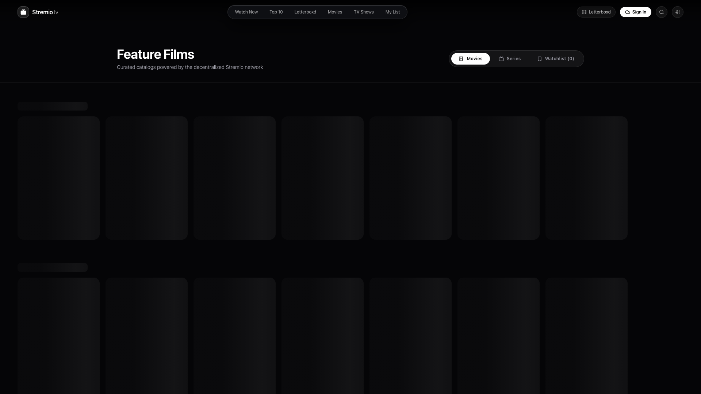
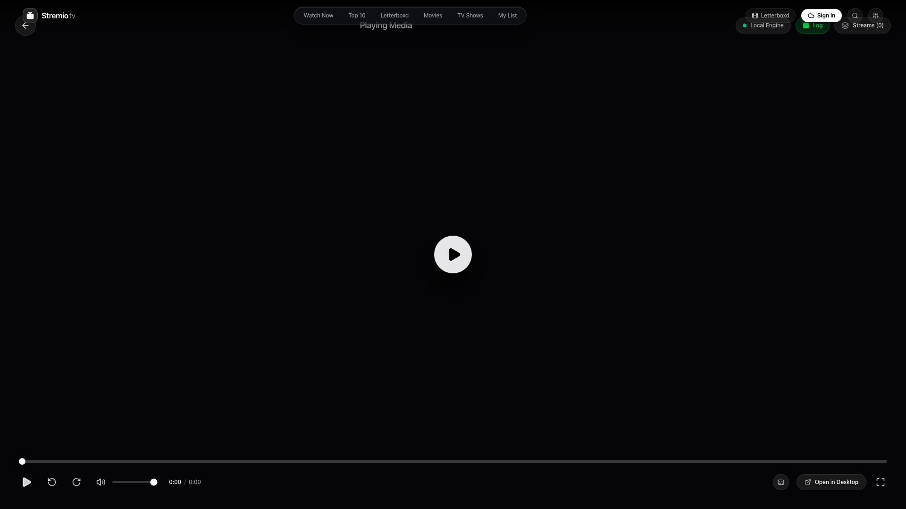
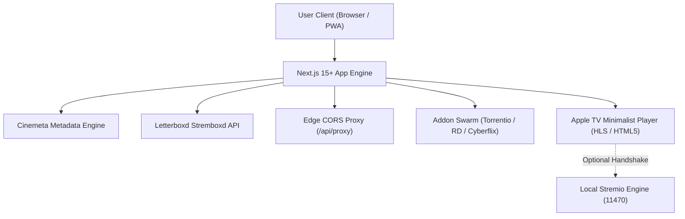

<div align="center">

# 📺 Stremio tv

### An open-source, production-ready Apple TV-inspired web interface for the decentralized Stremio addon ecosystem & Letterboxd cinephile community.

[](https://nextjs.org/)
[](https://react.dev/)
[](https://www.typescriptlang.org/)
[](https://tailwindcss.com/)
[](Dockerfile)
[](LICENSE)
[](CONTRIBUTING.md)

<p align="center">
  <a href="#-interface-gallery">Screenshots</a> •
  <a href="#-key-features">Key Features</a> •
  <a href="#-production-deployment">Deploy to Production</a> •
  <a href="#-letterboxd-integration">Letterboxd Sync</a> •
  <a href="#-stremio-addon-pipeline">Addon Protocol</a> •
  <a href="#-contributing">Contributing</a>
</p>

</div>

---

## 📸 Interface Gallery

<div align="center">

### Top Shelf Discovery & Floating Frosted Island

*Cinematic full-bleed hero artwork, Apple TV floating navigation pill, Top 10 rails, and Letterboxd cinephile rows.*

<br/>

### Title Overview & Episode Selection

*Detailed synopses, cast credits, season/episode cards with video previews, and frosted capsule actions.*

<br/>

### Curated Feature Film & TV Show Catalogs

*Segmented Apple TV navigation pills, high-demand cinema, and personalized watchlist grids.*

<br/>

### Sleek Apple TV Minimalist Video Player

*Clean white progress scrubber, live stream resolution switcher (Torrentio, RealDebrid, Cyberflix), subtitles picker, and in-player Letterboxd logger.*

</div>

---

## 🌟 Key Features

### 🍏 Authentic Apple TV Aesthetics (Anti-Slop Craftsmanship)
- **Cupertino Frosted Glass:** Deep `#050507` velvet canvas layered with `backdrop-blur-3xl`, soft boundaries (`border-white/[0.08]`), and pure white capsule buttons.
- **Top Shelf Hero:** Full-bleed cinematic artwork with muted preview trailers upon hovering and fluid slide transitions.
- **Fluid 3D Focus Cards:** Smooth scale lifts (`scale-[1.04]`), atmospheric elevation shadows (`shadow-[0_24px_48px_rgba(0,0,0,0.85)]`), and in-card muted preview trailers.
- **Editorial Typography:** Human, legible typography powered by [Plus Jakarta Sans](https://fonts.google.com/specimen/Plus+Jakarta+Sans) and SF Pro Display — free from generic AI neon volt accents or developer monospace clutter.

### 💚 Letterboxd Cinephile Integration
- **Live Watchlist Sync:** Connect any public Letterboxd handle to instantly sync your personal watchlist to the home shelf and library via the Stremboxd protocol.
- **In-App Diary Logging:** Log films to your Letterboxd diary directly from title cards, movie details, or the player HUD. Rate 1–5 stars, toggle likes, write reviews, and open deep links.
- **Cinephile Rails:** Browse Letterboxd's *Popular This Week* and *Top 250 Narrative Features* alongside IMDb ratings.

### ⚡ Multi-Addon Decentralized Streaming Swarm
- **Aggregated Providers:** Cinemeta metadata engine with real-time stream aggregation from **Torrentio**, **RealDebrid**, **Cyberflix**, **Annatar**, **Comet**, and **OpenSubtitles**.
- **Quality & Audio Detection:** Automatic parsing of resolution (`4K Ultra HD`, `1080p Full HD`, `720p`), HDR flavor (Dolby Vision, HDR10+), lossless audio formats (Dolby Atmos, DTS-HD), file sizes, and seeder health.
- **Dual Playback Engine:**
  - **In-Browser Web Streaming:** Streams direct HTTP, HLS, and Debrid cached streams natively in the browser without desktop software.
  - **Local Hardware Passthrough:** Automatic RFC 7233 handshake with local Stremio engine (port 11470) for VideoToolbox/NVENC hardware acceleration.
  - **1-Click Desktop MPV Handshake:** Deep-linking (`stremio:///detail/{type}/{id}`) for desktop playback transitions.

---

## 🚀 Production Deployment

Stremio tv is engineered for production deployment across cloud providers, Docker hosts, and serverless edge runtimes.

### Option 1: Docker / Self-Hosted (Recommended)

Run Stremio tv as an isolated production container with Docker Compose:

```bash
# Clone the repository
git clone https://github.com/Ayan645/stremiow.git
cd stremiow

# Launch with Docker Compose
docker compose up -d
```

The container starts with automatic healthchecks and serves the production build at `http://your-server-ip:3000`.

### Option 2: Deploy with Vercel

Deploy directly to Vercel with zero configuration:

[](https://vercel.com/new/clone?repository-url=https://github.com/Ayan645/stremiow)

*Note: All upstream addon requests and Stremboxd API calls are automatically routed through the built-in Next.js Edge proxy (`/api/proxy`), ensuring seamless CORS compatibility in cloud environments.*

### Option 3: Production Node.js Server

```bash
# Clone repository
git clone https://github.com/Ayan645/stremiow.git
cd stremiow

# Install dependencies
npm ci

# Build optimized production bundle
npm run build

# Start production server (runs on port 3000 by default)
PORT=3000 npm run start
```

For production process management with PM2:

```bash
npm install -g pm2
pm2 start npm --name "stremio-tv" -- run start
```

---

## ⚙️ Environment Configuration

| Variable | Default | Description |
| :--- | :--- | :--- |
| `PORT` | `3000` | Port for the HTTP production server |
| `NODE_ENV` | `production` | Node environment (`development` / `production`) |
| `NEXT_PUBLIC_APP_URL` | Auto-detected | Canonical URL for metadata and PWA manifest |

---

## 🧪 Automated QA Test Harness

Stremio tv includes an automated end-to-end QA test suite testing all endpoints, multi-addon classification algorithms, and live stream streams:

```bash
npm run test:qa
```

```
========================================================
QA TEST RESULTS SUMMARY
========================================================
Total Passed:  69
Total Failed:  0

🎉 ALL QA TESTS PASSED CLEANLY! Ready for production release.
```

---

## 🛠️ Architecture & Tech Stack



- **Framework:** Next.js (App Router, Turbopack, React 19)
- **Language:** TypeScript 5.0
- **Styling:** Tailwind CSS + Custom Apple TV Frosted Glass Tokens
- **State Management:** Zustand
- **Video Player:** Hls.js + HTML5 Native Video Pipeline
- **Icons:** Lucide React
- **Protocols:** Stremio Addon Protocol v3 & Stremboxd Letterboxd API

---

## 🤝 Contributing

Contributions are welcome! Please read the [Contributing Guidelines](CONTRIBUTING.md) before opening a pull request.

1. Fork the Project
2. Create your Feature Branch (`git checkout -b feat/AmazingFeature`)
3. Commit your Changes (`git commit -m 'feat: add amazing feature'`)
4. Verify tests pass (`npm run build && npm run test:qa`)
5. Push to the Branch (`git push origin feat/AmazingFeature`)
6. Open a Pull Request

---

## 📄 License

Distributed under the **MIT License**. See [LICENSE](LICENSE) for more information.
